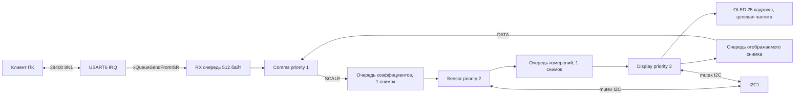

# Отчет по лабораторной работе №4

**Операционные системы реального времени. Вариант 2 «Компас».**

Студент: ____________________  Группа: ____________________

## 1. Цель работы

Изучить принципы работы FreeRTOS и применить вытесняющую многозадачность при разработке программы микроконтроллера.
Перенести функциональность компаса из лабораторной №3 на ОС РВ, обеспечив независимое обновление дисплея с частотой не менее 20 кадров/с.

## 2. Задание и исходные материалы

Программа должна измерять магнитное поле по трем осям, показывать значения и вектор поля на дисплее стенда,
принимать от ПК коэффициенты 0–200 %, по умолчанию 100 %, и передавать данные клиенту.
Нужны минимум две задачи, обработчик прерывания, счетчик кадров 0…99 и сравнение с вариантом без ОС.

За основу взят предоставленный архив `PVS3_FULL.zip`, SHA‑256:

```text
51c55fae51a6cd0075214a965bd8c0b3d565cb995c1617434372c0d213e504f3
```

Из него перенесены настройки STM32F427VI, драйверы магнитометра, дисплея, расширителя PCA9538, графические примитивы и шрифт.
Исходный код ПК-клиента сохранен без изменений. Исходный прикладной модуль ЛР3 помещен в `docs/lab3_reference` для непосредственного сравнения.
Отсутствовавшие в архиве файлы HAL I2C добавлены из STM32CubeF4 v1.27.0 — версии, указанной в исходном `.ioc`.

## 3. Аппаратная конфигурация

| Узел | Конфигурация |
|---|---|
| Стенд | SDK‑1.1M, процессорный модуль STM32F427VI |
| Частоты | HSE 25 МГц; PLL M=15, N=216, P=2; HCLK 180 МГц |
| APB | APB1 45 МГц, APB2 90 МГц; таймер TIM6 получает 90 МГц |
| Магнитометр | LSM9DS1, дополнительно сохранено автоопределение LSM9DS0 |
| Дисплей | SSD1306, 128×64, I2C; сброс через бит 0 PCA9538 |
| Общая I2C1 | PB8 SCL, PB9 SDA, 400 кГц, аппаратные подтяжки стенда |
| Связь с ПК | USART6, PC6 TX / PC7 RX, 38400 бит/с, 8N1 |
| Системные часы | SysTick 1 кГц для FreeRTOS; TIM6 1 кГц для HAL |

Драйвер определяет модель по WHO_AM_I. Для LSM9DS1 используются адрес 0x1E или 0x1C (7-битные), идентификатор 0x3D,
режим непрерывных измерений, диапазон ±4 Гс, BDU и чтение шести байт с автоинкрементом.
Вместо исходного CTRL_REG1_M=0x70 установлен 0x7C: частота выдачи данных 80 Гц.
Для LSM9DS0 сохранена поддержка идентификатора 0x49; CTRL_REG5_XM изменен с 0x70 на 0x74 (50 Гц).
Это позволяет получать новые измерения при опросе 25 раз в секунду. Преобразование в целые мГс сохранено из ЛР3:
0,14 мГс/LSB для DS1, 0,16 мГс/LSB для DS0, с усечением целой части.

## 4. Организация задач

Использовано ядро **FreeRTOS 10.6.2**, порт GCC ARM_CM4F, вытесняющее планирование, 1000 тиков/с.

| Задача | Приоритет | Стек | Период и действия |
|---|---:|---:|---|
| Display | 3 | 768 слов / 3072 байта | Каждые 40 мс: снимок измерений, текст, стрелка, счетчик и полный кадр OLED |
| Sensor | 2 | 512 слов / 2048 байт | Каждые 40 мс: чтение магнитометра, применение коэффициентов, направление |
| Comms | 1 | 768 слов / 3072 байта | Обработка до 64 байт за проход, затем задержка 2 мс; телеметрия каждые 200 мс |
| Idle | 0 | 128 слов / 512 байт | Системная задача ядра |

Для периодических задач применяется `xTaskDelayUntil`: следующая активация привязана к абсолютному расписанию,
поэтому время отрисовки не прибавляется к периоду. Если период пропущен, отсчет возобновляется от текущего времени,
а не выполняется серия ускоренных повторов. У Display фиксируется такой пропуск.



### Обмен данными и общие ресурсы

Три очереди длины 1 передают структуры по значению: коэффициенты, последнее измерение, отображаемый снимок.
`xQueueOverwrite` заменяет устаревшее значение, `xQueuePeek` получает копию без удаления.
Оси, угол и примененные коэффициенты передаются одним снимком; читатель не может получить часть старого и часть нового измерения.
Настройки принимаются целиком после проверки всех трех значений. Следующее измерение применяет новую тройку.

Шина I2C общая для датчика, OLED и расширителя. Все обращения защищены одним mutex FreeRTOS.
Наследование приоритета позволяет задаче Sensor, владеющей шиной, завершить транзакцию без вытеснения задачей Comms,
если Display ожидает этот mutex. Критические секции не охватывают передачу I2C или UART.

Буфер дисплея и графические функции принадлежат только Display. Драйвер магнитометра вызывает только Sensor.
Comms не обращается к I2C. UART передает целую строку по прерыванию, а задача Comms ожидает уведомление,
освобождая процессор для остальных задач. Длительное ожидание ответа ПК отсутствует.

## 5. Прерывания и системное время

Обработчик `USART6_IRQHandler` вызывает HAL. В `HAL_UART_RxCpltCallback` байт помещается в очередь через
`xQueueSendFromISR`, сразу запускается прием следующего байта. Парсинг, вычисления и отрисовка в ISR не выполняются.
По завершении передачи `HAL_UART_TxCpltCallback` уведомляет задачу связи через `vTaskNotifyGiveFromISR`.
`portYIELD_FROM_ISR` запрашивает переключение, если разбуженная задача должна выполняться.

Для Cortex‑M меньшее числовое значение NVIC означает более высокий приоритет:

| Источник | Приоритет NVIC | Использование ОС |
|---|---:|---|
| TIM6 | 4 | Только `HAL_IncTick`, API ядра не вызывает |
| Порог системных вызовов | 5 | `configLIBRARY_MAX_SYSCALL_INTERRUPT_PRIORITY` |
| USART6 | 6 | Разрешены функции `...FromISR` |
| SysTick / PendSV | 15 | Системные обработчики FreeRTOS |

Исходный приоритет USART6=0 заменен на 6, поскольку ISR теперь использует очередь ядра.
Пустые SVC/PendSV и bare-metal SysTick удалены; их имена сопоставлены обработчикам порта FreeRTOS.
HAL переведен с SysTick на TIM6, чтобы тайм-ауты периферии работали независимо от тиков планировщика.
При настройке TIM6 учтено удвоение частоты таймера при делителе APB1, равном 4.

## 6. Измерения, масштабирование и стрелка

Для каждой оси: `Bscaled = Braw × K / 100`, где K — целое число от 0 до 200.
Коэффициенты остаются в оперативной памяти до новой команды или аппаратного сброса; запись во Flash заданием не требуется.
После применения коэффициентов X/Y преобразуются в компоненты «вправо» и «вверх» с настройками ориентации из ЛР3.
Угол вычисляется как `atan2(right, up)` и нормируется в диапазон 0…359°.
При нулевой горизонтальной составляющей возвращается −1, вместо стрелки рисуется точка.

Дисплей показывает X/Y/Z в мГс, угол, коэффициенты и стрелку в окружности. Счетчик в правом нижнем углу
отображает 00…99 и увеличивается по модулю 100 после успешной отправки полного кадра.
Даже при отсутствии магнитометра задача дисплея продолжает выводить SENSOR ERROR и счетчик.
Измерения старше 200 мс признаются недействительными, чтобы не показывать старое направление как актуальное.

Сохранены `COMPASS_SWAP_XY=0`, `COMPASS_SIGN_X=1`, `COMPASS_SIGN_Y=1` из ЛР3.
Эти значения являются исходной настройкой, а не новым экспериментальным определением осей.
Для конкретного стенда нужно горизонтально повернуть плату, сопоставить вектор с известным направлением поля и при необходимости изменить перестановку и знаки.
Наклон не компенсируется: задание предполагает горизонтальную плату. Магнит и металл изменяют измеренный вектор, что естественно изменяет направление стрелки;
положение магнитного полюса влияет на знак направления.

## 7. Обоснование частоты дисплея

Размер кадра 1024 байта, дополнительно управляющий байт 0x40. При I2C 400 кГц только передача кадра занимает примерно
`1026 × 9 / 400000 = 23,1 мс`, включая адрес и ACK; установка окна занимает около 0,2 мс.
Период 40 мс дает расчетную частоту 25 кадров/с и оставляет около 16 мс для обработки, чтения датчика и других задач.
Display имеет наивысший прикладной приоритет. Получение готового снимка не ожидает датчик, а UART работает независимо.

Опросная передача I2C занимает процессор, но не запрещает прерывания. Это простой перенос существующего драйвера;
DMA мог бы сократить загрузку ЦП, но для данного объема обмена не обязателен.
Тайм-аут полной передачи OLED ограничен 30 мс. Время ожидания шины Display ограничено 5 мс.
Аппаратные сбои и повторная инициализация могут нарушить период и учитываются диагностикой.

**Расчет не доказывает фактические 20 кадров/с.** Подтверждение получают по числу завершенных кадров и времени,
а также максимальному промежутку между кадрами. Для этого реализованы STATS и `tools/check_fps.py`.

## 8. Сравнение ЛР3 и ЛР4

| Особенность | ЛР3: «голое железо» | ЛР4: FreeRTOS |
|---|---|---|
| Управление | Один `CompassApp_Process`, вручную сравниваются `HAL_GetTick` и временные метки | Три задачи и вытесняющий планировщик |
| Измерения | Раз в 100 мс | Задача Sensor, раз в 40 мс |
| OLED | Общий блок Render/Report раз в 200 мс: около 5 кадров/с | Display раз в 40 мс: целевые 25 кадров/с |
| ПК | UART IRQ и собственные кольцевые буферы; обработка в главном цикле | UART IRQ → очередь ОС → Comms, TX с уведомлением |
| Данные | Общие переменные внутри последовательного цикла | Целостные структуры в очередях |
| I2C | Вызовы последовательно из одной функции, mutex не нужен | Два владельца задач, обязателен общий mutex |
| Длительная обработка команды | Отодвигает очередной Render в основном цикле | Display вытесняет задачу связи |
| Планирование периода | Метка `last_report_ms = now`; возможен дрейф | Абсолютное расписание `xTaskDelayUntil` |
| Расход RAM | Общий стек и собственные UART-буферы | Отдельные стеки, TCB, очереди и heap ядра 24 КБ |
| Сложность | Простые зависимости, мало точек синхронизации | Приоритеты, владение ресурсами, ISR API и диагностика стеков |

Плюсы bare-metal для этого компаса: небольшая потребность в памяти, простота первоначальной настройки и отсутствие конфликтов I2C между задачами.
При коротких ограниченных обработчиках тот же период дисплея можно получить и без ОС, написав корректное кооперативное расписание.
Минусы исходной реализации: чтение, отрисовка, связь и повторы инициализации связаны общей последовательностью;
при расширении программы приходится вручную ограничивать время каждого участка и пересматривать весь цикл.

Плюсы FreeRTOS: независимые периоды, вытеснение задачи связи ради дисплея, готовые очереди и mutex,
явное разделение ответственности, возможность блокировать задачу на передаче без остановки остальной программы.
Минусы: дополнительные затраты памяти и переключений, более сложная отладка, риск инверсии приоритетов и гонок при неправильной синхронизации,
ограничения на приоритеты ISR. ОС не ускоряет I2C и не гарантирует сроки автоматически: необходимы расчет нагрузки и проверка на устройстве.

## 9. Проверка и результаты

### Выполненные программные проверки

Кросс-сборка выполнена Arm GNU Toolchain 13.2.Rel1, Cortex‑M4F, hard-float ABI, `-Og`.
Проверены компиляция исходников и линковка ELF, формирование BIN/HEX и таблицы памяти.
Для включенной сборки: text 28844 байта, data 1152 байта, bss 27104 байта;
образ BIN занимает 30000 байт. BSS уже включает резерв heap FreeRTOS 24 КБ, из которого выделяются задачи и очереди.
Тесты C проверяют четыре направления, нормирование вектора, отрицательные значения, коэффициенты 0/100/200,
неопределенное направление, синтаксис, переполнение чисел, атомарность изменения коэффициентов, CRLF,
переполнение строки и недопустимые байты. Три Python-теста подтверждают прием DATA, PONG, OK SCALE и ERR исходным клиентом ЛР3.
Автоматическая кросс-сборка и те же тесты включены в GitHub Actions.

Программные проверки не подтверждают работу электрических соединений, правильность знаков осей, поведение OLED и реальную частоту кадров.
Фактические аппаратные испытания в рамках подготовки этого отчета не выполнялись.

### План аппаратных испытаний

| Проверка | Ожидаемый результат | Фактический результат |
|---|---|---|
| Включение и PING | PONG, непрерывный счетчик на OLED | Заполнить на стенде |
| Горизонтальный поворот | Вектор сохраняет направление поля в пространстве | Заполнить на стенде |
| Магнит/металл | Изменяются оси и направление вектора | Заполнить на стенде |
| SCALE 200 100 0 | X удвоен, Z=0, настройки сохраняются | Заполнить на стенде |
| SCALE 201 100 100 | ERR RANGE, действующая тройка не меняется | Заполнить на стенде |
| SCALE 0 0 0 | Все оси 0, направление −1, точка | Заполнить на стенде |
| 30 с без нагрузки | ≥20 кадров/с, max_gap≤50 мс | Приложить idle.json |
| 30 с, 20 SCALE/с | ≥20 кадров/с, нет новых ошибок/пропусков | Приложить load.json |
| Сбой магнитометра | SENSOR ERROR, счетчик продолжает работать, поиск повторяется | Заполнить на стенде |

Команды воспроизведения приведены в README. Порт должен быть открыт только одной программой.
После испытаний записать измеренный минимум FPS, максимум промежутка между кадрами и найденные настройки ориентации;
приложить JSON, журнал клиента и фотографии дисплея. До этого аппаратный пункт задания остается неподтвержденным.

## 10. Вывод

Программа компаса перенесена с последовательного цикла ЛР3 на три задачи FreeRTOS, сохранены клиент и прикладной протокол.
Взаимодействие задач организовано через очереди и mutex; UART использует обработчики прерываний и ISR API ядра.
Добавлены периодическое обновление OLED, циклический счетчик и диагностика частоты кадров.
Код собран для STM32F427VI и проверен программными тестами. Выполнение требования по реальной частоте и ориентации стрелки необходимо подтвердить на стенде.

## 11. Источники

1. Предоставленные исходники ЛР3, `PVS3_FULL.zip`.
2. [Примеры производителя SDK‑1.1M](https://github.com/lmtspbru/SDK-1.1M).
3. [FreeRTOS Kernel 10.6.2](https://github.com/FreeRTOS/FreeRTOS-Kernel/tree/V10.6.2).
4. [FreeRTOS: периодическое выполнение задач](https://github.com/FreeRTOS/FreeRTOS-Website-Content/blob/main/content/en-us/Documentation/02-Kernel/04-API-references/02-Task-control/03-xTaskDelayUntil.md).
5. [FreeRTOS: приоритеты прерываний Cortex‑M](https://www.freertos.org/Documentation/02-Kernel/03-Supported-devices/04-Demos/ARM-Cortex/RTOS-Cortex-M3-M4).
6. [STMicroelectronics: LSM9DS1 datasheet](https://www.st.com/resource/en/datasheet/lsm9ds1.pdf).
7. [STM32CubeF4 v1.27.0](https://github.com/STMicroelectronics/STM32CubeF4/tree/v1.27.0).
